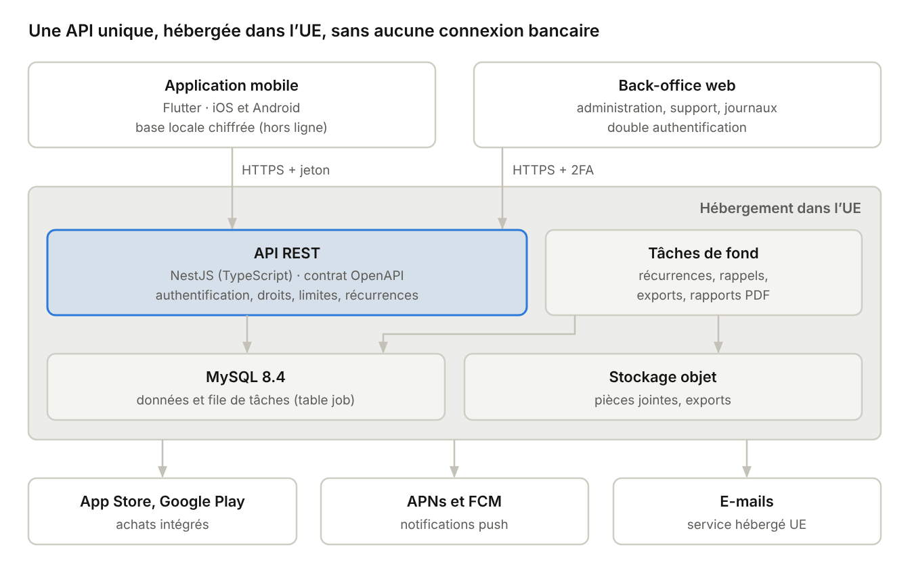
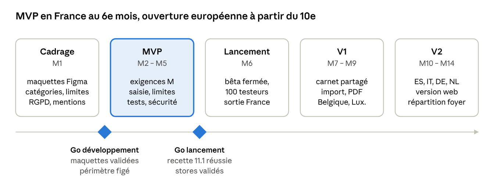

# Cahier des charges — Depenseo, application de suivi des dépenses (France et Europe)

Version du 4 novembre 2026, révision 2 : base de données MySQL (voir section 12)

## 1. Contexte et objectifs

**Depenseo** est une application mobile de suivi et de contrôle des dépenses personnelles, pour la France puis l'Europe. Elle s'inspire de BilliTime (application colombienne analysée le 3 novembre 2026), mais n'en garde que la partie dépenses : pas de revenus, pas de comptes bancaires, pas de gestion de budget complète.

Le projet est porté par un développeur indépendant. Se connecter aux banques, aux cartes ou à d'autres instruments financiers demande un agrément ou un contrat avec un prestataire agréé, hors de portée à ce stade : ces connexions sont exclues. Les dépenses sont saisies à la main ou importées depuis un fichier.

**Positionnement.** Depenseo répond en un coup d'œil à la question « combien ai-je dépensé ce mois-ci (ou cette semaine), et suis-je encore sous ma limite ? ». Là où BilliTime suit des revenus et des dépenses, Depenseo remplace les revenus par une **limite de dépense** mensuelle ou hebdomadaire, facultative.

**Objectifs mesurables (12 mois après le lancement)**

| Indicateur | Cible |
| --- | --- |
| Utilisateurs inscrits | 10 000 |
| Utilisateurs actifs mensuels | 40 % des inscrits |
| Dépenses saisies par utilisateur actif et par semaine | ≥ 10 |
| Utilisateurs actifs ayant défini une limite de dépense | ≥ 60 % |
| Conversion vers le plan payant | 4 % des actifs |
| Rétention à 30 jours | ≥ 30 % |
| Note moyenne sur les stores | ≥ 4,5 / 5 |

## 2. Périmètre

Le MVP couvre une application mobile iOS et Android pour la France, en français et en anglais, centrée sur les seules dépenses. Elle n'affiche jamais de revenu, de solde ni de « reste à vivre ».

| Sujet | Inclus | Exclu |
| --- | --- | --- |
| Plateformes | iOS 15+, Android 8+ (API 26) ; version web consultative en V2 | Montres, tablettes optimisées (simple adaptation responsive) |
| Pays | France au lancement ; Belgique, Luxembourg, Espagne, Italie, Allemagne, Pays-Bas en V1/V2 | Pays hors Espace économique européen |
| Langues | Français et anglais au MVP ; espagnol, italien, allemand, néerlandais ensuite | Traduction automatique non relue |
| Devises | Euro par défaut ; dépenses en devise étrangère converties en euros | Cryptomonnaies |
| Données suivies | Dépenses saisies, dépenses récurrentes, dépenses importées d'un fichier, limites de dépense | Revenus, soldes, épargne, dettes, crédits, patrimoine, budget prévisionnel complet |
| Connexions financières | Aucune | Comptes bancaires, cartes de crédit, synchronisation DSP2, lecture des notifications ou SMS bancaires, initiation de paiement |
| Utilisateurs | Particuliers, couples et familles | Entreprises, notes de frais professionnelles (piste V3) |

## 3. Utilisateurs cibles et parcours clés

La cible principale est l'actif français de 22 à 45 ans qui sent qu'il dépense trop sans savoir où, et veut une règle simple : « pas plus de X € par mois ou par semaine ».

| Persona | Profil | Besoin principal | Fonctions décisives |
| --- | --- | --- | --- |
| Camille, 29 ans | Salariée à Lyon, paie surtout par carte | Ne plus dépasser 600 € de dépenses courantes par mois | Limite mensuelle, alertes à 80 % et 100 %, saisie rapide |
| Hugo, 22 ans | Étudiant boursier, petit job | Tenir 70 € par semaine pour les sorties et les courses | Limite hebdomadaire, rappel quotidien de saisie, version gratuite complète |
| Karim et Léa, 36 et 34 ans | Couple avec un enfant | Suivre ensemble les dépenses du foyer | Carnet partagé, limite commune, répartition des dépenses |
| Martine, 58 ans | Fonctionnaire, beaucoup de charges annuelles | Ne plus être surprise par la taxe foncière ou les assurances | Dépenses récurrentes, rappels, vue des dépenses à venir |

**Parcours clés à réussir**

1. Installation, inscription et première dépense saisie en moins d'une minute.
2. Saisie quotidienne d'une dépense en moins de 10 secondes, y compris hors connexion.
3. Choix d'une limite mensuelle ou hebdomadaire, ou décision de ne pas en fixer.
4. Alerte avant dépassement, puis consultation de la répartition par catégorie pour savoir où réduire.
5. Bilan de fin de période : total dépensé, comparaison avec la période précédente, export.

## 4. Exigences fonctionnelles

Le MVP regroupe les exigences « M ». Les priorités suivent la méthode MoSCoW : **M** = indispensable au MVP, **S** = attendu en V1, **C** = souhaitable en V2, **W** = hors périmètre pour l'instant. Aucune exigence ne suppose une connexion à une banque, à une carte ou à un autre instrument financier.

### 4.1 Compte utilisateur et sécurité

| ID | Exigence | Priorité |
| --- | --- | --- |
| F-AUTH-01 | Inscription par e-mail et mot de passe, avec vérification de l'e-mail | M |
| F-AUTH-02 | Connexion avec Apple et Google | M |
| F-AUTH-03 | Réinitialisation du mot de passe par lien à usage unique (validité 30 min) | M |
| F-AUTH-04 | Verrouillage de l'app par biométrie ou code, délai réglable (immédiat, 1 min, 5 min) | M |
| F-AUTH-05 | Masquage des montants d'un geste (mode discret) | S |
| F-AUTH-06 | Gestion des appareils connectés et déconnexion à distance | S |
| F-AUTH-07 | Suppression du compte et de toutes les données depuis l'app, sans passer par le support | M |
| F-AUTH-08 | Export complet des données personnelles (JSON et CSV) | M |
| F-AUTH-09 | Utilisation sans compte en mode local, avec création de compte plus tard pour sauvegarder et synchroniser | C |

### 4.2 Dépenses

| ID | Exigence | Priorité |
| --- | --- | --- |
| F-DEP-01 | Saisie d'une dépense en moins de 10 secondes depuis l'accueil (bouton « + » toujours visible) | M |
| F-DEP-02 | Clavier numérique adapté à la langue : virgule décimale en français, point accepté et converti | M |
| F-DEP-03 | Champs : montant, catégorie, date, note, marchand ou lieu, étiquettes | M |
| F-DEP-04 | Moyen de paiement facultatif sous forme de simple libellé (carte, espèces, virement, chèque, titre-restaurant), sans compte ni solde associé | S |
| F-DEP-05 | Modèles de saisie rapide (« Café 2,50 € », « Plein d'essence ») proposés selon l'historique | S |
| F-DEP-06 | Ventilation d'une dépense sur plusieurs catégories (ex. courses + pharmacie) | S |
| F-DEP-07 | Pièce jointe : photo ou PDF d'un ticket ou d'une facture | S |
| F-DEP-08 | Dépense en devise étrangère, convertie en euros au taux BCE du jour de la dépense | S |
| F-DEP-09 | Recherche par texte, montant, catégorie et période ; filtres combinables | M |
| F-DEP-10 | Modification et suppression avec annulation possible pendant 5 secondes | M |
| F-DEP-11 | Remboursement d'une dépense (retour produit, remboursement d'un proche) lié à la dépense d'origine, qui réduit le total dépensé sans être un revenu | C |

### 4.3 Catégories

| ID | Exigence | Priorité |
| --- | --- | --- |
| F-CAT-01 | Plan de catégories adapté à la France : Logement, Énergie, Courses, Restaurants, Transports, Santé, Assurances, Impôts et taxes, Enfants, Loisirs, Shopping, Abonnements, Cadeaux, Divers, avec sous-catégories | M |
| F-CAT-02 | Catégories personnalisées (nom, icône, couleur), masquables | M |
| F-CAT-03 | Catégorie proposée automatiquement à la saisie, à partir de la note, du marchand et des choix passés | S |
| F-CAT-04 | Règles : « toujours classer "Monoprix" en Courses », appliquées à la saisie et à l'import | S |

### 4.4 Dépenses récurrentes

| ID | Exigence | Priorité |
| --- | --- | --- |
| F-REC-01 | Dépense récurrente : nom, montant fixe ou estimé, fréquence (hebdomadaire, mensuelle, trimestrielle, annuelle, ponctuelle), jour, catégorie | M |
| F-REC-02 | À l'échéance, enregistrement automatique de la dépense ou demande de confirmation (au choix par récurrence) | M |
| F-REC-03 | Ajuster le montant réel, marquer payée ou sauter une échéance | M |
| F-REC-04 | Rappels configurables (J-3, jour J) à l'heure locale de l'utilisateur | M |
| F-REC-05 | Total mensuel des dépenses fixes, et part de la limite déjà engagée par elles | S |
| F-REC-06 | Modèles français pré-remplis : loyer, électricité, box internet, forfait mobile, assurance habitation, mutuelle, taxe foncière, abonnements de streaming | S |

### 4.5 Limites de dépense

La limite de dépense remplace la notion de revenu de BilliTime. Elle est **facultative** : sans limite, Depenseo reste un simple carnet de dépenses.

| ID | Exigence | Priorité |
| --- | --- | --- |
| F-LIM-01 | Limite globale facultative, sur une période mensuelle ou hebdomadaire au choix | M |
| F-LIM-02 | Début de période réglable : jour du mois (ex. le 28, date de paie) ou jour de la semaine (lundi par défaut) | M |
| F-LIM-03 | Affichage du dépensé sur la limite, du montant restant avant la limite et du rythme (« 62 % de la limite consommée à 40 % du mois ») | M |
| F-LIM-04 | Alertes à 80 % et 100 % de la limite, puis à chaque dépassement significatif | M |
| F-LIM-05 | Choix d'inclure ou non les dépenses récurrentes dans la limite | M |
| F-LIM-06 | Projection de fin de période au rythme actuel (« à ce rythme, 720 € pour une limite de 600 € ») | S |
| F-LIM-07 | Limites facultatives par catégorie (ex. 150 € de restaurants par mois) | S |
| F-LIM-08 | Historique : périodes tenues ou dépassées, écart moyen, série de périodes tenues | S |
| F-LIM-09 | Changement de limite sans réécrire l'historique : chaque période garde la limite en vigueur à l'époque | M |

### 4.6 Import et export de fichiers

| ID | Exigence | Priorité |
| --- | --- | --- |
| F-IMP-01 | Import d'un relevé exporté par l'utilisateur depuis sa banque (CSV, Excel .xlsx, OFX) : seules les lignes de débit sont importées, les crédits sont ignorés | S |
| F-IMP-02 | Détection du séparateur, du format de date et de la virgule décimale ; aperçu avant import avec catégories proposées | S |
| F-IMP-03 | Détection des doublons déjà saisis (même montant, date ± 3 jours) | S |
| F-IMP-04 | Modèles d'import mémorisés par fichier source | C |
| F-EXP-01 | Export Excel et CSV des dépenses sur une période choisie | M |
| F-EXP-02 | Rapport PDF de fin de période : total, limite, répartition par catégorie, liste des dépenses | S |

### 4.7 Tableau de bord et analyses

| ID | Exigence | Priorité |
| --- | --- | --- |
| F-TB-01 | Accueil : jauge dépensé / limite de la période en cours (ou total dépensé sans limite), prochaines dépenses récurrentes, dernières dépenses | M |
| F-TB-02 | Graphiques : répartition par catégorie, dépenses cumulées de la période comparées à la précédente, évolution sur 12 périodes | M |
| F-TB-03 | Analyses automatiques : catégorie en hausse par rapport à la moyenne, abonnements accumulés, jour de la semaine le plus dépensier | S |
| F-TB-04 | Sections de l'accueil réordonnables et masquables | C |
| F-TB-05 | Widget d'écran d'accueil iOS et Android (dépensé / limite, bouton d'ajout) | S |

### 4.8 Partage (couple et famille)

| ID | Exigence | Priorité |
| --- | --- | --- |
| F-PAR-01 | Carnet de dépenses partagé avec d'autres personnes par invitation (lien ou e-mail), rôle propriétaire ou membre | S |
| F-PAR-02 | Chaque membre voit toutes les dépenses du carnet et ne modifie que les siennes | S |
| F-PAR-03 | Limite commune au carnet, en plus des limites personnelles | S |
| F-PAR-04 | Répartition des dépenses communes (50/50 ou parts fixes) et solde « qui doit quoi » entre membres | C |
| F-PAR-05 | Retrait d'un membre et révocation immédiate de l'accès | S |

### 4.9 Notifications

| ID | Exigence | Priorité |
| --- | --- | --- |
| F-NOT-01 | Notifications push : limite à 80 % et 100 %, dépense récurrente à venir, dépense inhabituellement élevée | M |
| F-NOT-02 | Rappel quotidien facultatif de saisie, à l'heure choisie (« Avez-vous noté vos dépenses du jour ? ») | M |
| F-NOT-03 | Résumé de fin de période (semaine ou mois) | S |
| F-NOT-04 | Réglage par type de notification et plage de silence | M |
| F-NOT-05 | Aucun montant affiché sur l'écran verrouillé si le mode discret est actif | M |

### 4.10 Abonnement et administration

| ID | Exigence | Priorité |
| --- | --- | --- |
| F-ABO-01 | Achats intégrés App Store et Google Play, vérifiés côté serveur, avec notifications serveur des stores | M |
| F-ABO-02 | Essai gratuit de 14 jours du plan Premium | M |
| F-ABO-03 | Restauration des achats et accès multi-appareils lié au compte | M |
| F-ADM-01 | Back-office web séparé de l'application mobile : utilisateurs, abonnements, journaux, statistiques, avec double authentification | M |
| F-ADM-02 | Aucun écran ni code d'administration embarqué dans l'application publique | M |

## 5. Offre et monétisation

Depenseo est gratuit pour l'essentiel et propose un seul plan payant, sans publicité : un suivi de dépenses inspire confiance s'il ne revend pas l'attention de ses utilisateurs, et l'absence de SDK publicitaire simplifie la conformité. Les prix sont des hypothèses à valider par un test de prix.

| Plan | Prix (TTC) | Contenu |
| --- | --- | --- |
| Gratuit | 0 € | Dépenses illimitées, catégories personnalisées, une limite globale (mensuelle ou hebdomadaire), dépenses récurrentes et rappels, graphiques de la période, export CSV |
| Premium | 2,49 € / mois ou 19,99 € / an | Limites par catégorie, carnet partagé en famille, import de relevés, export Excel et rapport PDF, pièces jointes, dépenses en devises, analyses automatiques, historique des limites, widget |

**Règles d'accès**

- Essai Premium de 14 jours, sans engagement.
- À la fin du Premium, aucune donnée n'est supprimée : les fonctions Premium passent en lecture seule.
- Le carnet partagé suit le plan de son propriétaire : les membres invités n'ont pas besoin d'être abonnés.
- Résiliation en un clic depuis l'application, vers la gestion d'abonnement du store (loi du 16 août 2022, résiliation en trois clics).
- Commission des stores : 15 % pour un développeur indépendant sous 1 M$ de revenus annuels (programmes Small Business d'Apple et de Google), à intégrer au calcul du prix.

## 6. Exigences réglementaires (France et UE)

Sans connexion à une banque, à une carte ni à un autre instrument financier, Depenseo ne fournit aucun service de paiement : aucun agrément de l'ACPR n'est nécessaire. Les obligations restantes portent surtout sur les données personnelles et la vente d'abonnements. Ces points sont rédigés de mémoire et doivent être validés par un juriste.

| Domaine | Texte | Exigence pour le projet |
| --- | --- | --- |
| Services de paiement | DSP2 (directive 2015/2366) | Hors champ tant que l'app ne lit aucun compte et n'initie aucun paiement. Toute évolution vers l'agrégation bancaire passera par un prestataire agréé et fera l'objet d'un nouveau cadrage. |
| Données personnelles | RGPD, loi Informatique et Libertés | Registre des traitements, analyse d'impact (AIPD) recommandée car les dépenses révèlent les habitudes de vie, minimisation, durées de conservation, droits d'accès, de portabilité et d'effacement dans l'app (F-AUTH-07 et 08). |
| Localisation des données | RGPD, chapitre V | Hébergement et sauvegardes dans l'UE. Tout sous-traitant hors UE (e-mail, support, mesure d'audience) encadré par clauses contractuelles types ou décision d'adéquation. |
| Traceurs et SDK | Directive ePrivacy, recommandations CNIL | Aucun SDK publicitaire, aucun identifiant publicitaire. Mesure d'audience exemptée de consentement si configurée selon la CNIL, sinon demande de consentement. |
| Accessibilité | Acte européen sur l'accessibilité (depuis le 28 juin 2025), RGAA, WCAG 2.1 niveau AA | Une micro-entreprise de services est en principe exemptée de l'Acte européen ; viser quand même WCAG 2.1 AA : lecteurs d'écran, contrastes, tailles de texte dynamiques. |
| Consommation | Code de la consommation, loi du 16 août 2022 | Prix TTC, CGU et CGV, information sur le renouvellement, résiliation simple. |
| Intelligence artificielle | Règlement IA (2024/1689) | La catégorie proposée automatiquement n'est pas un système à haut risque ; elle reste toujours modifiable. |
| Stores | Règles Apple App Store et Google Play | Fiches de confidentialité exactes ; sur Google Play, déclaration indiquant qu'aucun service financier n'est proposé ; compte de démonstration pour la revue. |
| Statut du développeur | Code de commerce, droit fiscal | Activité déclarée (micro-entreprise ou société) pour encaisser les reversements des stores ; TVA des ventes collectée et reversée par Apple et Google. |

**Mentions obligatoires dans l'application** : mentions légales, politique de confidentialité, CGU et CGV, contact pour les données personnelles, déclaration d'accessibilité.

## 7. Exigences non fonctionnelles

Les montants et les dates sont les deux points où une erreur détruit la confiance : ils ont des règles dédiées, testables automatiquement.

### 7.1 Montants, dates et formats

| ID | Exigence |
| --- | --- |
| NF-FMT-01 | Montants stockés en entiers de centimes (ou décimal exact), jamais en nombre à virgule flottante ; devise ISO 4217 stockée avec chaque montant. En base : `BIGINT` pour les centimes, `DECIMAL` pour les taux de change, jamais `FLOAT` ni `DOUBLE`. |
| NF-FMT-02 | Une date de dépense, d'échéance ou de début de période est une **date calendaire sans heure ni fuseau** (format AAAA-MM-JJ). Elle n'est jamais convertie en UTC. |
| NF-FMT-03 | Les horodatages techniques (création, modification) sont stockés en UTC et affichés dans le fuseau de l'appareil. |
| NF-FMT-04 | « Aujourd'hui », les semaines (du lundi au dimanche en France), les mois et les périodes de limite sont calculés dans le fuseau de l'utilisateur. |
| NF-FMT-05 | Tests automatisés des calculs de dates dans au moins 4 fuseaux (Paris, Lisbonne, Montréal, La Réunion) et autour des changements d'heure. |
| NF-FMT-06 | Format des nombres selon la langue (1 234,56 € en français) ; saisie tolérante (virgule ou point acceptés comme séparateur décimal). |
| NF-FMT-07 | La base et son pilote respectent NF-FMT-02 et 03 : une colonne `DATE` est lue comme une chaîne AAAA-MM-JJ, jamais comme un objet date ; serveur et connexions MySQL en UTC (section 8.2). |

### 7.2 Sécurité

| ID | Exigence |
| --- | --- |
| NF-SEC-01 | Chiffrement en transit (TLS 1.2 minimum, 1.3 de préférence) et au repos (base, sauvegardes, fichiers) ; clés gérées par un service de gestion de clés. |
| NF-SEC-02 | Jetons d'accès courts (15 min) et jetons de rafraîchissement révocables, stockés dans le trousseau iOS ou le Keystore Android. |
| NF-SEC-03 | Contrôle d'accès vérifié côté serveur sur chaque ressource (dépense, carnet, membre) ; tests automatisés contre l'accès aux données d'un autre utilisateur. |
| NF-SEC-04 | Respect du référentiel OWASP MASVS niveau L2 ; auto-évaluation avant le lancement, test d'intrusion externe dès que les revenus le permettent. |
| NF-SEC-05 | Captures d'écran bloquées sur les écrans sensibles (option), contenu masqué dans le sélecteur d'applications. |
| NF-SEC-06 | Aucune donnée personnelle ni montant dans les journaux applicatifs ; journaux d'audit des accès administrateurs. |

### 7.3 Performance, disponibilité et hors-ligne

| ID | Exigence |
| --- | --- |
| NF-PERF-01 | Ouverture de l'app jusqu'à l'accueil affiché en moins de 2 s sur un téléphone milieu de gamme de 2023. |
| NF-PERF-02 | 95 % des appels d'API en moins de 300 ms (hors génération de rapports). |
| NF-DISP-01 | Disponibilité mensuelle de l'API ≥ 99,5 % ; sauvegarde quotidienne, perte de données maximale 1 h, reprise en moins de 4 h. La perte maximale de 1 h suppose, en plus de la sauvegarde quotidienne, la conservation des journaux binaires MySQL (restauration à un instant donné). |
| NF-OFF-01 | Consultation hors connexion des données déjà chargées ; saisie hors ligne synchronisée au retour du réseau, sans doublon. |

### 7.4 Qualité et exploitation

| ID | Exigence |
| --- | --- |
| NF-QUA-01 | Couverture de tests automatisés ≥ 70 % sur la logique métier (totaux de période, limites, projections, récurrences, dédoublonnage). |
| NF-QUA-02 | Taux de sessions sans plantage ≥ 99,5 %, mesuré par un outil de suivi des erreurs hébergé dans l'UE. |
| NF-QUA-03 | Intégration et déploiement continus ; environnements de développement, recette et production séparés, avec données fictives hors production. Même version de MySQL (8.4) partout, tests automatisés compris (conteneur Docker en CI) : jamais SQLite ni un autre moteur pour simuler la base. |
| NF-QUA-04 | Accessibilité WCAG 2.1 AA vérifiée à chaque version sur les parcours clés. |

## 8. Architecture et stack technique

L'architecture est volontairement sobre pour qu'un développeur seul puisse la construire et l'exploiter : Flutter pour le mobile (comme BilliTime), une API TypeScript et une seule base MySQL, qui sert aussi de file de tâches. Tout est hébergé dans l'UE.

L'application ne parle qu'à l'API. Aucun service ne contacte une banque : les seuls services externes sont les stores (abonnements), l'envoi des notifications push et l'envoi d'e-mails.

### 8.1 Stack recommandée

| Couche | Choix recommandé | Raison |
| --- | --- | --- |
| Application mobile | Flutter 3 (Dart), gestion d'état Riverpod, base locale chiffrée (Drift + SQLCipher) | Une base de code pour iOS et Android ; saisie hors ligne |
| Graphiques | fl_chart | Déjà éprouvé dans BilliTime |
| Back-office | Application web légère (Next.js ou AdminJS) | Séparée de l'app publique (F-ADM-02) |
| API | Node.js 22, NestJS, TypeScript, contrat OpenAPI | Typage de bout en bout, structure claire pour un développeur seul |
| Base de données | MySQL 8.4 LTS géré (InnoDB), chiffrement au repos, sauvegardes quotidiennes et restauration à un instant donné | Fiabilité transactionnelle, version maintenue jusqu'en 2032 |
| Accès aux données | Drizzle ORM sur le pilote mysql2, migrations SQL versionnées | Requêtes typées ; dates calendaires lues en chaînes (NF-FMT-07) |
| Tâches de fond | File de tâches dans MySQL (table `job`, verrouillage `SKIP LOCKED`), planification par @nestjs/schedule | pg-boss ne fonctionne qu'avec PostgreSQL ; pas de Redis à exploiter |
| Fichiers | Stockage objet compatible S3, chiffré | Pièces jointes, exports |
| Hébergement | Scaleway, OVHcloud ou Clever Cloud (France), conteneurs gérés et MySQL 8.4 géré (offre à confirmer chez l'hébergeur retenu) | Données dans l'UE, peu d'administration système |
| Authentification | Module intégré à l'API (e-mail, Apple, Google) | Pas de service tiers hors UE |
| Abonnements | Vérification directe des reçus App Store et Google Play, ou RevenueCat | Gain de temps ; RevenueCat à encadrer (sous-traitant hors UE) |
| Notifications | APNs et Firebase Cloud Messaging (contenu sans montant) | Seul moyen d'envoyer un push sur iOS et Android |
| Suivi des erreurs et audience | Sentry (hébergement UE) ; mesure d'audience exemptée de consentement | Conformité CNIL |
| CI/CD | GitHub Actions et Fastlane | Publications reproductibles |

### 8.2 Contraintes liées à MySQL

MySQL est retenu à la place de PostgreSQL. Ce choix ne change ni les fonctions ni l'application mobile, dont la base locale reste SQLite (Drift et SQLCipher). Il change la façon d'écrire le schéma, les requêtes et la file de tâches. Les règles ci-dessous évitent que le changement de moteur réintroduise les défauts de dates et de montants relevés dans BilliTime (section 9).

| Sujet | Règle |
| --- | --- |
| Version et moteur | MySQL 8.4 LTS, moteur InnoDB. Ni MySQL 8.0, en fin de support depuis avril 2026, ni MariaDB, dont le JSON, les fonctions UUID et certains comportements diffèrent. |
| Encodage | `utf8mb4` et collation `utf8mb4_0900_ai_ci` pour toute la base : accents et emojis (icônes de catégories) stockés sans perte, recherche F-DEP-09 insensible à la casse et aux accents (« energie » trouve « Énergie »). Jamais `utf8`, qui désigne l'ancien encodage sur 3 octets. |
| Montants | `BIGINT` en centimes, `DECIMAL(18,8)` pour les taux de change, `CHAR(3)` pour la devise (NF-FMT-01). |
| Dates calendaires | Type `DATE`. Par défaut, le pilote mysql2 transforme un `DATE` en objet `Date` JavaScript à minuit dans le fuseau du serveur : c'est le décalage d'un jour observé dans BilliTime. Le mode chaîne (`dateStrings: ['DATE']`, ou `mode: 'string'` dans Drizzle) est obligatoire et vérifié par la suite multi-fuseaux (NF-FMT-05). |
| Horodatages | `DATETIME(3)` en UTC. Serveur réglé sur `default_time_zone = '+00:00'`, connexions ouvertes avec `timezone: 'Z'`. Pas de `TIMESTAMP`, limité à 2038 et converti selon le fuseau de la session. |
| Identifiants | UUID v7 générés par l'application, y compris hors ligne, stockés en `BINARY(16)`. MySQL n'a ni type UUID ni clause `RETURNING` : l'identifiant est connu avant l'insertion. |
| Saisie hors ligne sans doublon | L'identifiant créé sur le téléphone rend l'envoi idempotent : `INSERT … ON DUPLICATE KEY UPDATE`, équivalent de `ON CONFLICT` (NF-OFF-01). |
| Synchronisation différentielle | Colonne `updated_at` sur chaque table synchronisée, index `(notebook_id, updated_at, id)`. Le curseur porte sur le couple `(updated_at, id)`, car plusieurs lignes peuvent partager un horodatage. Les suppressions sont logiques (`deleted_at`) pour atteindre les autres appareils, purgées après 30 jours, et immédiatement à la suppression du compte (F-AUTH-07). |
| Types structurés | Pas de type tableau : étiquettes et membres de carnet en tables de liaison. `JSON` réservé aux données jamais filtrées en SQL (charges utiles des tâches, réglages). |
| Unicité conditionnelle | Pas d'index partiel. Exemple : une limite globale a une catégorie vide, et deux `NULL` ne se gênent pas dans un index unique. Une colonne générée (catégorie ou valeur fixe pour « globale ») entre dans l'index unique `(carnet, période, catégorie, date d'effet)`. |
| Transactions et verrous | Isolation `READ COMMITTED` pour les connexions de l'API (InnoDB est en `REPEATABLE READ` par défaut, avec plus de verrous de plage et d'interblocages). Nouvelle tentative automatique sur interblocage (erreur 1213) et sur attente de verrou dépassée (1205). |
| Migrations | Une instruction de schéma valide implicitement la transaction en cours : une migration interrompue ne s'annule pas d'elle-même. Une migration par changement, rejouée en recette avant la production, avec `ALGORITHM=INSTANT` ou `INPLACE` quand c'est possible pour ne pas bloquer les tables. |
| Sécurité | `require_secure_transport = ON` (TLS obligatoire), chiffrement au repos de l'offre gérée, sauvegardes et journaux binaires compris. Comptes séparés : API (lecture et écriture, sans droit sur le schéma), migrations, back-office (NF-SEC-06). |
| Sauvegardes | Sauvegarde complète quotidienne, journaux binaires conservés au moins 7 jours pour restaurer à un instant donné (NF-DISP-01). Une restauration est testée avant le lancement, puis chaque trimestre. |

**File de tâches.** pg-boss, prévu dans la version précédente, ne fonctionne qu'avec PostgreSQL. BullMQ imposerait Redis, que l'architecture veut éviter. La file reste donc dans la base, sous la forme d'un petit module de l'API :

- une table `job` : type, charge utile JSON (sans montant ni donnée personnelle superflue, NF-SEC-06), date d'exécution en UTC, nombre de tentatives, statut, clé d'unicité ;
- la tâche est créée dans la même transaction que la donnée qui la motive (une récurrence, une demande d'export) : pas de tâche orpheline ni de tâche perdue ;
- les workers prennent les tâches dues par `SELECT … FOR UPDATE SKIP LOCKED`, disponible depuis MySQL 8.0, ce qui permet plusieurs conteneurs sans double traitement ;
- la clé d'unicité (par exemple `occurrence:<id>`) empêche de planifier deux fois la même échéance ou le même rappel ;
- en cas d'échec, nouvelle tentative avec délai croissant, puis statut « en échec » visible dans le back-office après 5 essais ;
- la planification périodique (échéances du jour, rappels à l'heure locale, résumés de période) passe par @nestjs/schedule, protégée par `GET_LOCK()` pour qu'une seule instance planifie à la fois ;
- les tâches terminées sont purgées après 7 jours.

### 8.3 Modèle de données principal

Tous les identifiants sont des UUID v7 (section 8.2).

| Entité | Champs clés |
| --- | --- |
| User | id, e-mail, langue, fuseau horaire, devise, plan, dates de consentement |
| Notebook | carnet de dépenses : id, nom, propriétaire, membres et rôles (personnel par défaut, partagé en option) |
| Expense | id, carnet, auteur, montant en centimes, devise d'origine, montant converti, date calendaire, catégorie, note, marchand, moyen de paiement (libellé), étiquettes (table de liaison), source (saisie, récurrence, import), dépense remboursée liée, dates de modification et de suppression logique |
| Category / Rule | catégorie (nom, icône, couleur, parent) ; règle (motif de note ou de marchand → catégorie) |
| RecurringExpense / Occurrence | modèle (fréquence, jour, montant, enregistrement automatique ou non) ; échéance (date, statut, dépense liée) |
| SpendingLimit | carnet, période (mois ou semaine), jour de début, montant, catégorie (vide = limite globale), inclut les récurrences, date d'effet |
| Attachment | dépense, type, taille, clé de stockage |
| Subscription | store, identifiant d'achat, plan, début, fin, statut de renouvellement |
| Job | file de tâches : type, charge utile, date d'exécution, tentatives, statut, clé d'unicité |

### 8.4 API

API REST versionnée (`/v1`), décrite en OpenAPI, avec pagination par curseur et synchronisation différentielle (`updated_since`, curseur `(updated_at, id)`, section 8.2) pour la saisie hors ligne. Ressources principales : `/auth`, `/me`, `/notebooks`, `/expenses`, `/categories`, `/rules`, `/recurring-expenses`, `/limits`, `/imports`, `/exports`, `/attachments`, `/subscriptions`. Les notifications des stores arrivent sur des points d'entrée dédiés, signés et vérifiés.

## 9. Enseignements de l'analyse de BilliTime

L'analyse de BilliTime 1.1.7 (analyse statique de l'APK et tests sur un Xiaomi 15, le 3 novembre 2026) a révélé sept défauts. Chacun devient une exigence explicite de Depenseo, ou une raison de l'exclure du périmètre.

| Défaut observé dans BilliTime | Effet pour l'utilisateur | Réponse de Depenseo |
| --- | --- | --- |
| Dates décalées d'un jour en UTC+1 (achat du 3 nov. affiché le 2, relevé du 15 affiché le 14) | Rappels un jour trop tôt, historique faux | NF-FMT-02 à 05 et 07, section 8.2 |
| « 42.50 » saisi devient 4 250 (point lu comme séparateur de milliers) | Montants décuplés sans avertissement | F-DEP-02, NF-FMT-06 |
| Module publicitaire chargé même pour un abonné, identifiants de test Google en production, aucun recueil de consentement | Non-conformité RGPD et ePrivacy en Europe, aucun revenu publicitaire réel | Aucune publicité (section 5), règles sur les traceurs (section 6) |
| Console d'administration embarquée dans l'app publique | Surface d'attaque inutile, révèle les routes internes | F-ADM-01 et 02 |
| Détection des opérations par lecture des notifications bancaires annoncée mais inactive | Fonction promise absente ; approche fragile et intrusive | Exclue (section 2) ; saisie rapide (4.2) et import de fichier (4.6) |
| Bloc « Your week » incohérent avec les dépenses de la semaine | Perte de confiance dans les chiffres | F-LIM-02, NF-FMT-04, tests NF-QUA-01 |
| Une seule langue latino-américaine et prix sans devise affichée | Inadapté hors Colombie | Sections 2 et 5 |

**À reprendre de BilliTime** : saisie en trois gestes, aperçu avant import avec détection des doublons, catégorie proposée automatiquement, dépenses récurrentes avec bouton « payer » ou « sauter », projection de fin de période, accueil personnalisable.

**À laisser de côté** : revenus, soldes de comptes, cartes de crédit et achats en plusieurs fois, dettes, objectifs d'épargne. Ils supposent de suivre l'argent qui entre et les comptes, ce que Depenseo ne fait pas.

## 10. Planning, charge et budget indicatif

Un développeur seul peut sortir le MVP en France environ 6 mois après le démarrage, pour environ 113 jours de travail et 1 100 à 6 500 € de frais externes la première année. Ces chiffres sont des estimations.

Deux jalons conditionnent la suite : le développement ne démarre qu'avec les maquettes validées et le périmètre figé ; le lancement public n'a lieu qu'après la recette (section 11.1) et la validation des stores.

### 10.1 Charge du MVP (M1 à M6)

| Activité | Charge (jours) |
| --- | --- |
| Cadrage, maquettes et système de design | 15 |
| Application mobile Flutter (saisie, limites, récurrences, graphiques, hors ligne) | 45 |
| API, base de données MySQL (dont file de tâches), back-office | 33 |
| Tests automatisés, recette, corrections | 15 |
| Publication sur les stores, documents juridiques, conformité | 5 |
| **Total** | **113** |

La file de tâches écrite dans l'API (section 8.2) ajoute environ 3 jours par rapport à pg-boss. À temps plein, 113 jours représentent environ 5 mois ; à mi-temps, compter 10 à 11 mois et décaler la feuille de route d'autant.

### 10.2 Frais externes de la première année

| Poste | Montant estimé |
| --- | --- |
| Programme développeur Apple | 99 $ par an |
| Compte développeur Google Play | 25 $, une seule fois |
| Hébergement UE (API, base MySQL gérée, stockage, sauvegardes) | 20 à 50 € par mois |
| Nom de domaine et e-mail professionnel | 30 à 80 € par an |
| Dépôt de la marque Depenseo à l'INPI (une classe) | environ 190 € |
| Relecture des CGU, CGV et politique de confidentialité par un avocat | 500 à 1 500 € |
| Audit de sécurité léger (optionnel) | 2 000 à 4 000 € |
| **Total première année** | **environ 1 100 à 6 500 €** |

La V1 et la V2 demandent ensuite environ 80 jours de développement supplémentaires, traductions comprises (traducteurs relecteurs : environ 0,10 € par mot).

## 11. Recette, livrables, risques et questions ouvertes

Le MVP est accepté quand toutes les exigences « M » passent leurs tests et que les critères ci-dessous sont mesurés sur la version candidate.

### 11.1 Critères de recette

- [ ] 100 % des exigences « M » couvertes par au moins un cas de test réussi
- [ ] Installation → première dépense saisie en moins d'une minute pour 8 testeurs sur 10
- [ ] Saisie d'une dépense en moins de 10 secondes (médiane sur 20 saisies)
- [ ] Catégorie proposée correcte pour au moins 80 % de 500 dépenses de test
- [ ] Aucun écart de date, de période ni de montant sur la suite de tests multi-fuseaux (NF-FMT-05)
- [ ] Limites mensuelles et hebdomadaires justes aux changements de période, de mois et d'heure
- [ ] Suite multi-fuseaux et tests de l'API exécutés contre MySQL 8.4, avec la configuration de production (UTC, dates en chaînes, `utf8mb4`)
- [ ] Migrations rejouées depuis une base vide et sur la base de recette sans erreur ; restauration d'une sauvegarde à un instant donné réussie
- [ ] Auto-évaluation OWASP MASVS sans point critique ouvert
- [ ] Vérification d'accessibilité (VoiceOver, TalkBack, contrastes) sur les parcours clés
- [ ] Validation par Apple et Google en production

### 11.2 Livrables du projet

| Livrable | Contenu |
| --- | --- |
| Code source | Application mobile, API, back-office, scripts d'infrastructure, versionnés sur GitHub |
| Documentation | Ce cahier des charges, architecture, API (OpenAPI), modèle de données et migrations MySQL, procédures de sauvegarde et de reprise |
| Design | Maquettes Figma, système de design |
| Tests | Tests automatisés, rapport de recette |
| Conformité | Registre des traitements, AIPD, mentions légales, CGU et CGV, fiches de confidentialité des stores |

### 11.3 Principaux risques

| Risque | Probabilité | Impact | Parade |
| --- | --- | --- | --- |
| La saisie manuelle lasse les utilisateurs, qui abandonnent | Élevée | Élevé | Saisie en 10 s, modèles rapides, dépenses récurrentes automatiques, rappel quotidien, widget, import de relevés |
| Projet dépendant d'une seule personne | Élevée | Élevé | Architecture simple, tests automatisés, documentation, déploiement automatisé |
| Concurrence d'applications plus complètes (avec synchronisation bancaire) | Élevée | Moyen | Positionnement assumé : simplicité, limite de dépense, aucune donnée bancaire demandée |
| Faible conversion vers le Premium | Moyenne | Moyen | Test de prix, essai de 14 jours, valeur Premium visible (partage, limites par catégorie) |
| Demande forte de synchronisation bancaire | Moyenne | Moyen | Import de relevés en V1 ; agrégation via un prestataire agréé étudiée seulement si les revenus le justifient |
| Erreurs propres à MySQL : dates converties par le pilote, interblocages, migration interrompue à moitié, file de tâches écrite à la main | Moyenne | Élevé | Règles de la section 8.2, tests contre MySQL 8.4 en CI, migrations répétées en recette, échecs de tâches visibles dans le back-office |

### 11.4 Questions ouvertes

- La marque « Depenseo » et le nom de domaine sont-ils disponibles (INPI, EUIPO, depenseo.fr / .com) ?
- Les limites par catégorie restent-elles Premium, ou passent-elles dans le plan gratuit ?
- Faut-il un mode sans compte (F-AUTH-09) dès le MVP pour réduire la friction à l'installation ?
- Le code de l'application sera-t-il public (open source) comme ce cahier des charges, ou privé ?
- Quel budget et quels canaux d'acquisition au lancement ?
- L'hébergeur retenu propose-t-il MySQL 8.4 géré dans l'UE, avec chiffrement au repos et restauration à un instant donné ? Sinon, quel hébergeur choisir ?

## 12. Historique des versions

| Version | Date | Changement |
| --- | --- | --- |
| 1 | 4 novembre 2026 | Première version, base PostgreSQL 16 et file de tâches pg-boss |
| 2 | 4 novembre 2026 | Base de données MySQL 8.4 à la place de PostgreSQL : stack (8.1), nouvelles contraintes et file de tâches dans MySQL (8.2), entité Job (8.3), NF-FMT-01, NF-FMT-07, NF-DISP-01, NF-QUA-03, charge (+3 jours), recette, risques, questions ouvertes, schéma d'architecture |
